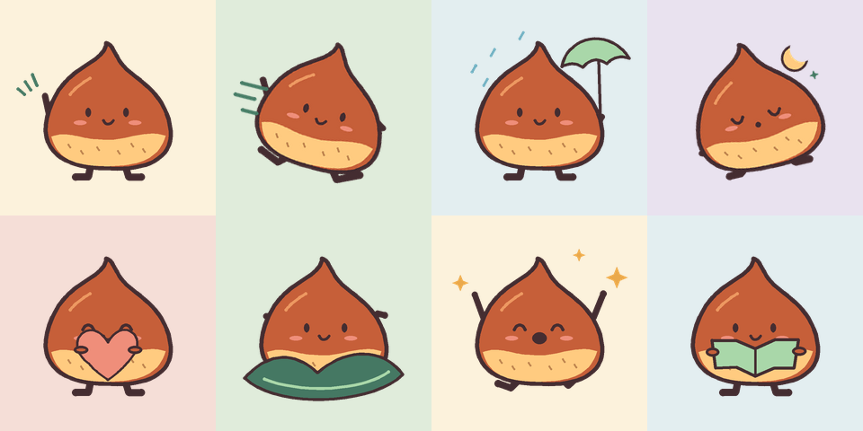

# 栗子巡游 · Chestnut Walk



This complete static album includes eight numbered PNG stickers and five supplementary images. The JSON manifest controls their order, paths and submission text. Every shape, expression, background and the repository icon is drawn by the included Pillow script from coordinates. The drawings have no external asset, font, AI or network dependencies.

From this directory, after installing the toolkit, run:

```sh
wechat-sticker inventory --all
wechat-sticker validate --all
wechat-sticker build --all --offline
```

To exercise the missing-artwork workflow, copy this directory to a scratch folder. Move `supplementary/banner.png` out of that copy, then run `wechat-sticker assets briefs --all` and build again. Restore the banner and rebuild to obtain a complete package.

The distributed PNG files are ready to use. To regenerate them locally with Pillow installed, run `python generate.py`. Re-running writes the files shown here. PNG encoders can produce different file bytes across library versions. The sample name and account eligibility require the usual platform checks before any actual submission.

## Artwork provenance and license

The sample illustrations, supplementary artwork, repository icon, preview and generator are original materials distributed under the [repository MIT License](../../LICENSE). The generator draws its pixels from geometric primitives and uses no source images, fonts or third-party artwork. Creators retain the rights to artwork they bring to their own projects.
